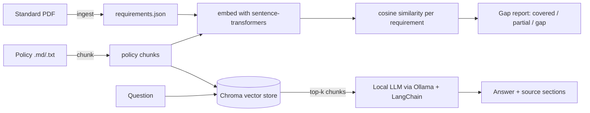

# PolicyLens

Compare a security policy against a public standard (starting with PCI DSS) using sentence embeddings, then ask questions about the policy through a RAG chat.

> **Status:** student project (v0.1). It is a review aid, not an audit tool. It does not tell you whether an organisation is compliant. See [Limitations](#limitations).

## What it does

1. **Parses a standard** (PDF) into structured requirements (`req_id`, `title`, `text`).
2. **Detects gaps.** Each requirement is matched to the most similar chunk of the policy. The similarity score becomes `covered`, `partial` or `gap`.
3. **Answers questions** about the policy in a chat (RAG: retrieve relevant policy sections, then have a local LLM answer from them only, and say so when the policy is silent).
4. **Evaluates itself** against a hand-labelled answer key (precision, recall, F1, threshold sweep).

Everything runs locally. No policy text is sent to an external service.

## How it works



More detail in [docs/ARCHITECTURE.md](docs/ARCHITECTURE.md).

## Quick start

Requirements: Python 3.10+, [Ollama](https://ollama.com) (only for the chat).

```bash
git clone https://github.com/noshin-nawar5/policylens.git
cd policylens

python -m venv .venv
source .venv/bin/activate          # Windows: .venv\Scripts\activate
pip install -r requirements.txt

ollama pull llama3.2               # only needed for chat
```

**Get the standard.** PCI DSS is free but copyrighted, so it is not included in this repo. Download it and save it as `data/standards/PCI-DSS-v4_0_1.pdf`. Steps in [docs/DATA.md](docs/DATA.md).

```bash
# 1. Parse the standard (add --debug to also dump raw lines for inspection)
policylens ingest pci-dss-4 --debug

# 2. Check the output by eye, then run gap detection on the sample policy
policylens gap --standard pci-dss-4 --policy data/policies/finco_policy.md

# 3. Launch the web app
streamlit run app/streamlit_app.py
```

Run all commands from the repo root. The first run downloads the embedding model (about 90 MB) from Hugging Face, so it needs internet once.

### Command-line reference

| Command | Purpose |
|---|---|
| `policylens ingest <standard-id> [--debug]` | PDF to `data/processed/<id>.json` |
| `policylens gap --standard ID --policy FILE` | Gap report as CSV and table |
| `policylens init-key <standard-id>` | Blank answer key to label by hand |
| `policylens eval [--sweep]` | Score the report against the answer key |
| `policylens ask "question" --policy FILE` | One-off RAG question (needs Ollama) |

## Evaluating it

1. `policylens init-key pci-dss-4`
2. Read each requirement and the policy, then fill the `label` column in `data/eval/answer_key.csv` (`covered`, `partial`, `gap`) **before** looking at the model output.
3. `policylens gap ...` then `policylens eval --sweep`

Method and caveats in [docs/EVALUATION.md](docs/EVALUATION.md).

### Results

| Embedding model | Covered/partial/gap thresholds | Macro-F1 | Gap recall | Gap precision |
|---|---|---|---|---|
| all-MiniLM-L6-v2 | _to fill after evaluation_ | | | |
| all-mpnet-base-v2 | _to fill after evaluation_ | | | |

## Project structure

```
config/standards.yaml      registry of supported standards
data/policies/             fictional sample policy (FinCo)
data/eval/                 answer key (hand-labelled)
data/standards/            put downloaded standard PDFs here (git-ignored)
data/processed/            generated JSON and reports (git-ignored)
src/policylens/
    ingest.py              PDF -> requirements JSON
    chunking.py            policy -> chunks
    gap.py                 embeddings + similarity + labels
    rag.py                 LangChain + Chroma + Ollama chat
    evaluate.py            metrics and threshold sweep
    cli.py                 command-line interface
app/streamlit_app.py       web UI
tests/                     unit tests (no model download needed)
docs/                      architecture, data, evaluation notes
```

## Adding another standard

1. Download the document (check its licence first).
2. Add a block to `config/standards.yaml` with its own `id`, `pdf`, `output`, `include_top_level` and `noise_patterns`.
3. Run `policylens ingest <id> --debug` and inspect the result.
4. If the numbering style differs from `6.4.1`, adjust `REQ_RE` in `src/policylens/ingest.py`.

## Limitations

- **Similarity is not compliance.** A policy chunk can discuss the same topic as a requirement without meeting it. The tool will over-report coverage in some cases. Always review matches manually.
- **Small test set.** The sample policy is fictional and short. Numbers from it should not be generalised.
- **Parser is layout-dependent.** The PDF parser was written against a regex pattern, not tuned for every PDF. Check the output of `ingest`.
- **Policy formats.** Only `.md` and `.txt` policies are supported for now.
- **LLM answers can be wrong.** RAG reduces unsupported answers but does not remove them. Sources are always shown so you can verify.
- Embedding models truncate long inputs (MiniLM at about 256 tokens), so long requirements may lose their tail.

## Roadmap

- [ ] LLM verification pass: ask a model whether the matched chunk actually satisfies the requirement
- [ ] PDF/DOCX policy upload
- [ ] More standards (e.g. OWASP ASVS)
- [ ] Compare several embedding models in one report

## Disclaimer and data

- No real company policy or confidential data is used anywhere in this project. The FinCo policy is invented.
- PCI DSS is the property of the PCI Security Standards Council. This repo does not redistribute it.
- The tool gives indications for human reviewers. It is not legal, audit or compliance advice.

## Tested with

Python 3.11. Imports for `langchain-core 1.8.x`, `langchain-chroma 1.2.x` and `langchain-ollama 1.2.x` were checked at release. Run `pip freeze > requirements-lock.txt` in your working environment and commit it to pin versions.

## Licence

MIT. See [LICENSE](LICENSE).

## Author

Noshin Nawar ([GitHub](https://github.com/noshin-nawar5) | [LinkedIn](https://www.linkedin.com/in/noshin-nawar5) | [Hugging Face](https://huggingface.co/noshin-nawar))
