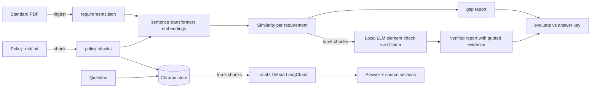

# PolicyLens

Check a security policy against a public standard (PCI DSS) using sentence embeddings and a small local LLM, then ask questions about the policy through a RAG chat.

> **Status:** student project (v0.1), evaluated on one section of one standard and one fictional policy. It is a review aid for a human reviewer, **not** an audit or compliance verdict. Read [Results](#results) and [Limitations](#limitations) before relying on any output.

## What it does

1. **Parses a standard** (PDF) into structured requirements (`req_id`, `text`, section, objective, applicability notes).
2. **Detects gaps with embeddings.** Each requirement is matched to the most similar chunk of the policy. The similarity score becomes `covered`, `partial` or `gap`.
3. **Verifies with a local LLM.** For each requirement, an LLM splits it into elements and says whether the policy states each one, quoting evidence. The status is derived by code from the elements, and an element only counts if its quote really appears in the policy text.
4. **Answers questions** about the policy (RAG with LangChain + Chroma + a local LLM) and says when the policy is silent.
5. **Evaluates itself** against a hand-labelled answer key (accuracy, per-class precision/recall/F1, macro-F1, threshold sweep).

Everything runs locally. No policy text is sent to an external service.

## How it works



More detail in [docs/ARCHITECTURE.md](docs/ARCHITECTURE.md).

## Quick start

Requirements: Python 3.10+. [Ollama](https://ollama.com) is only needed for `verify`, `ask` and the chat tab.

```bash
git clone https://github.com/noshin-nawar5/policylens.git
cd policylens

python -m venv .venv
source .venv/bin/activate          # Windows PowerShell: .venv\Scripts\activate
pip install -r requirements.txt    # large download: includes PyTorch
```

**Get the standard.** PCI DSS is free but copyrighted, so it is not included. Download PCI DSS v4.0.1 and save it as `data/standards/PCI-DSS-v4_0_1.pdf`. Details in [docs/DATA.md](docs/DATA.md).

```bash
policylens ingest pci-dss-4 --debug      # parse Requirement 6 (expect 19 requirements)
policylens gap                           # embedding-based gap report on the sample policy
streamlit run app/streamlit_app.py       # web app
```

For the LLM features:

```bash
ollama pull llama3.2                     # about 2 GB
policylens verify                        # LLM element-by-element check
policylens ask "What does the policy say about code review?"
```

Run all commands from the repo root. The first `gap` run downloads the embedding model from Hugging Face (about 90 MB for MiniLM, about 400 MB for MPNet), so it needs internet once.

### Command reference

| Command | Purpose |
|---|---|
| `policylens ingest <standard-id> [--debug]` | PDF to `data/processed/<id>.json` |
| `policylens gap [--model M] [--chunk-mode paragraph\|sentence] [--out FILE]` | Embedding gap report |
| `policylens verify [--llm NAME] [--prompt v1\|v2] [--top-k N] [--only 6.5.5,6.4.1] [--out FILE]` | LLM element check (needs Ollama) |
| `policylens init-key <standard-id>` | Blank answer key to label by hand |
| `policylens eval [--report FILE] [--key FILE] [--sweep]` | Score a report against the answer key |
| `policylens ask "question" [--llm NAME]` | One-off RAG question (needs Ollama) |

`--model` defaults to `all-MiniLM-L6-v2`; `all-mpnet-base-v2` is the other model tested. Add `--help` to any command for all options.

## Results

Requirement 6 of PCI DSS v4.0.1 (19 requirements) against the fictional FinCo policy, scored against a hand-labelled key (2 covered, 10 partial, 7 gap). Default thresholds (covered at 0.55, partial at 0.40), no tuning.

| Method | Accuracy | Macro-F1 | Gap precision | Gap recall |
|---|---|---|---|---|
| MiniLM, paragraph chunks | 0.26 | 0.20 | 0.33 | 0.14 |
| MPNet, paragraph chunks | 0.42 | 0.38 | 0.67 | 0.29 |
| MiniLM, sentence chunks | 0.21 | 0.17 | 0.00 | 0.00 |
| MPNet, sentence chunks | 0.26 | 0.21 | 0.00 | 0.00 |
| llama3.2 3B, prompt v1 | 0.68 | 0.61 | 0.60 | 0.43 |
| llama3.2 3B, prompt v2 | 0.47 | 0.39 | 0.50 | 0.14 |
| qwen2.5 3B, prompt v1 | 0.42 | 0.28 | 0.38 | 0.86 |

Prompt v2 was written after seeing the v1 error on requirement 6.5.5, so it is partly tuned to that case. Threshold sweeps (`policylens eval --sweep`) score higher, but they tune on the same 19 rows they are scored on, so they are optimistic and not reported here.

### What the results suggest

- **Embedding similarity alone cannot separate covered from partial.** It finds the right topic, not whether every element is stated. Sentence-sized chunks made this worse, because short sentences share wording with requirements and everything looked covered.
- **Small local LLMs are unstable.** The same model scored 0.68 or 0.47 depending on the instruction wording, and a second model (qwen2.5) was far too strict. With 19 rows, the best number may be partly luck.
- **Most useful as triage.** The tool is better at surfacing candidate gaps with quoted evidence for a human to confirm than at giving a verdict.

Results were produced on a laptop with 8 GB RAM and no GPU, which limited the LLMs to about 3B parameters.

## Evaluating it yourself

1. `policylens init-key pci-dss-4` creates a blank key.
2. Read each requirement and the policy, then fill the `label` column (`covered`, `partial`, `gap`) **before** looking at tool output.
3. `policylens gap ...` or `policylens verify ...`, then `policylens eval --report <file>`.

The key in this repo was drafted with AI assistance and reflects a single reviewer's judgement; some rows are borderline (see `docs/answer_key_rationale.md`). Rule used: *covered* = the policy states the control including every element; *partial* = some elements stated with specifics; *gap* = not mentioned, or only a generic statement. Method and caveats in [docs/EVALUATION.md](docs/EVALUATION.md).

## Project structure

```
config/standards.yaml      registry of supported standards and PDF layout settings
data/policies/             fictional sample policy (FinCo)
data/eval/                 answer key (hand-labelled)
data/standards/            put downloaded standard PDFs here (git-ignored)
data/processed/            generated JSON and reports (git-ignored)
src/policylens/
    ingest.py              PDF -> requirements JSON (layout-aware)
    chunking.py            policy -> chunks (paragraph or sentence)
    gap.py                 embeddings + similarity + labels
    verify.py              LLM element-by-element check with evidence guard
    rag.py                 LangChain + Chroma + Ollama chat
    evaluate.py            metrics and threshold sweep
    cli.py                 command-line interface
app/streamlit_app.py       web UI (gap report tab, chat tab)
tests/                     unit tests (no model download needed)
docs/                      architecture, data, evaluation notes
```

## Extending it

**More requirements from PCI DSS:** in `config/standards.yaml`, add the top-level numbers to `include_top_level` and widen `layout.pages` (PDF page numbers, 1-based). Note that the sample policy only covers software development and change management, so other requirements will mostly show as gaps; test them with a policy that covers them.

**Another standard:** add a block to `config/standards.yaml`. For single-column documents leave out `layout` (plain mode); for multi-column tables like PCI DSS add a `layout` block with the column x-range and page range. Run `policylens ingest <id> --debug` and inspect the output. If the numbering style differs from `6.4.1`, adjust the regexes at the top of `src/policylens/ingest.py`.

## Limitations

- **Similarity is not compliance.** A policy chunk can discuss the same topic as a requirement without meeting it.
- **Small, single-labeller test.** 19 requirements, one fictional policy, and one set of labels. Do not generalise the numbers.
- **The evidence check is shallow.** It confirms a quoted sentence exists in the policy text, not that the sentence actually supports the element. A model can quote an unrelated sentence and pass.
- **LLM output varies** with model, prompt wording and, to a small degree, between runs. 3B-parameter models are weak at this task.
- **The parser is layout-specific.** Layout settings were measured on the PCI DSS v4.0.1 PDF (a 3-column table, left column only). Other editions or documents need their own settings.
- **Policy formats.** Only `.md` and `.txt` policies are supported.
- Embedding models truncate long inputs (MiniLM at about 256 tokens), so long requirements may lose their tail.
- The RAG chat is implemented, but end-to-end testing with a live model is still pending.

## Roadmap

- [ ] Larger LLM and a second human labeller
- [ ] Stronger evidence check (does the quote support the element?)
- [ ] PDF/DOCX policy upload
- [ ] Remaining PCI DSS requirements, and more standards (e.g. OWASP ASVS)
- [ ] Test the chat tab end to end and document it

## Disclaimer and data

- No real company policy or confidential data is used anywhere in this project. The FinCo policy is invented.
- PCI DSS is the property of the PCI Security Standards Council. This repo does not redistribute it.
- Output is an indication for human reviewers, not legal, audit or compliance advice.

## Development

```bash
pip install -r requirements.txt
pytest
```

Tests use a fake embedder and a fake LLM, so they need no model downloads. CI runs them on Python 3.11. Run `pip freeze > requirements-lock.txt` in a working environment and commit it to pin versions. See [CONTRIBUTING.md](CONTRIBUTING.md).

## Licence

MIT. See [LICENSE](LICENSE).

## Author

Noshin Nawar ([GitHub](https://github.com/noshin-nawar5) | [LinkedIn](https://www.linkedin.com/in/noshin-nawar5) | [Hugging Face](https://huggingface.co/noshin-nawar))